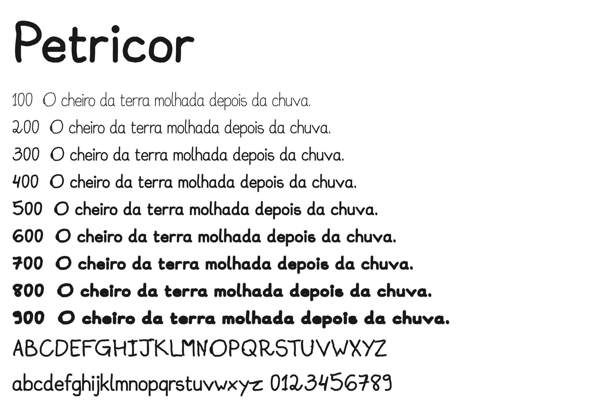
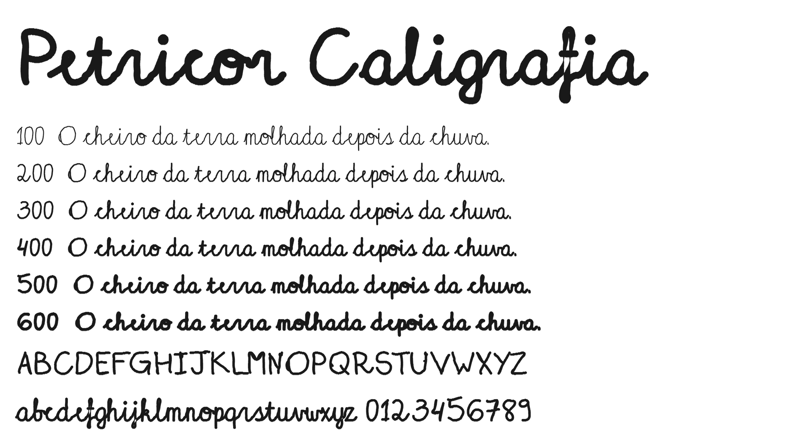

# Petricor





**Petricor** é uma família tipográfica livre feita a partir da caligrafia de Mário Lúcio. O nome vem do cheiro da terra molhada depois da chuva. São duas famílias, com as mesmas maiúsculas, algarismos e símbolos:

| Família | Minúsculas | Pesos | Para quê |
|---|---|---|---|
| **Petricor** | de forma (separadas) | Thin 100 → Black 900 | blogs, textos corridos, interfaces |
| **Petricor Caligrafia** | cursivas que se conectam de verdade | Thin 100 → SemiBold 600 | títulos, convites, peças afetivas |

As duas são **fontes variáveis** (eixo `wght`) e cobrem o conjunto **GF Latin Core** (português, espanhol, francês, alemão, polonês, tcheco e outras línguas latinas). Recursos OpenType: `calt` (conexões da cursiva), `kern`, `mark`, `ccmp` e `tnum` (algarismos tabulares).

> **English summary.** Petricor is an open-source handwriting family based on the handwriting of Mário Lúcio, in two sibling families sharing capitals, figures and symbols: *Petricor* (print lowercase, wght 100–900) and *Petricor Caligrafia* (connected cursive lowercase via `calt`, wght 100–600). Both are variable fonts covering GF Latin Core, licensed under the SIL Open Font License 1.1.

## Baixar e usar

Os arquivos prontos ficam em [`fonts/`](fonts/): `variable/` (fontes variáveis), `ttf/` e `otf/` (estáticas) e `webfonts/` (`.woff2`).

## Como a fonte é feita

A letra foi escrita à mão em duas folhas do fontmaker.co ([`sources/scans/`](sources/scans/)). Um pipeline em Python ([`tools/petricor/`](tools/petricor/)):

1. separa a tinta das guias e vetoriza cada letra como **esqueleto** (linha central do traço);
2. harmoniza alturas e proporções sem apagar a mão do autor;
3. redesenha as cursivas com entradas e saídas padronizadas, para que se conectem;
4. dá espessura ao traço como uma caneta de ponta redonda, do Thin ao Black;
5. monta acentos, kerning e regras OpenType e gera os masters UFO em [`sources/masters/`](sources/masters/).

## Compilar

```bash
python -m venv .venv
.venv/bin/pip install -r requirements.txt   # Windows: .venv\Scripts\pip
gftools builder sources/config.yaml           # gera fonts/
```

Para regenerar os masters a partir dos esqueletos: `python -m petricor derive && python -m petricor masters` (com `tools/` no `PYTHONPATH` ou após `pip install -e .`).

Controle de qualidade (ambiente separado, porque o verificador conflita com o gftools):

```bash
python -m venv .venv-qa && .venv-qa/bin/pip install -r requirements-qa.txt
.venv-qa/bin/fontbakery check-googlefonts "fonts/variable/Petricor[wght].ttf" "fonts/variable/PetricorCaligrafia[wght].ttf"
```

A documentação técnica completa (requisitos, arquitetura, testes e decisões de design) está em [`specs/`](specs/).

## Licença

Este Font Software é licenciado sob a [SIL Open Font License, Versão 1.1](OFL.txt). Veja também [AUTHORS.txt](AUTHORS.txt) e [CONTRIBUTORS.txt](CONTRIBUTORS.txt).
